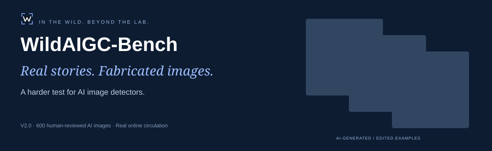
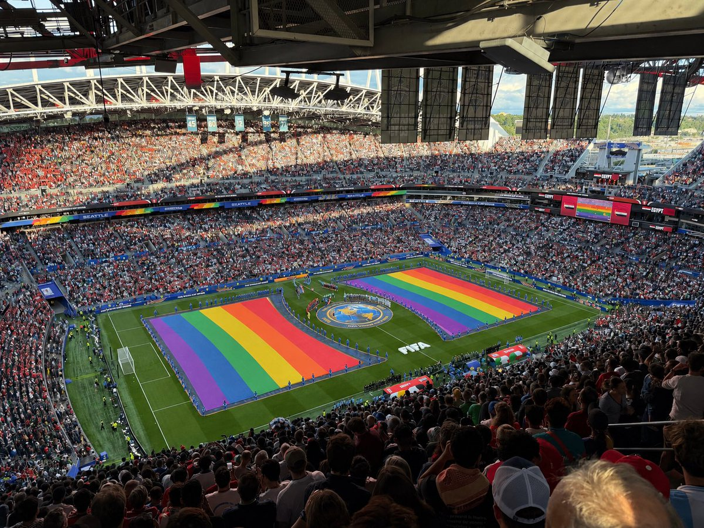
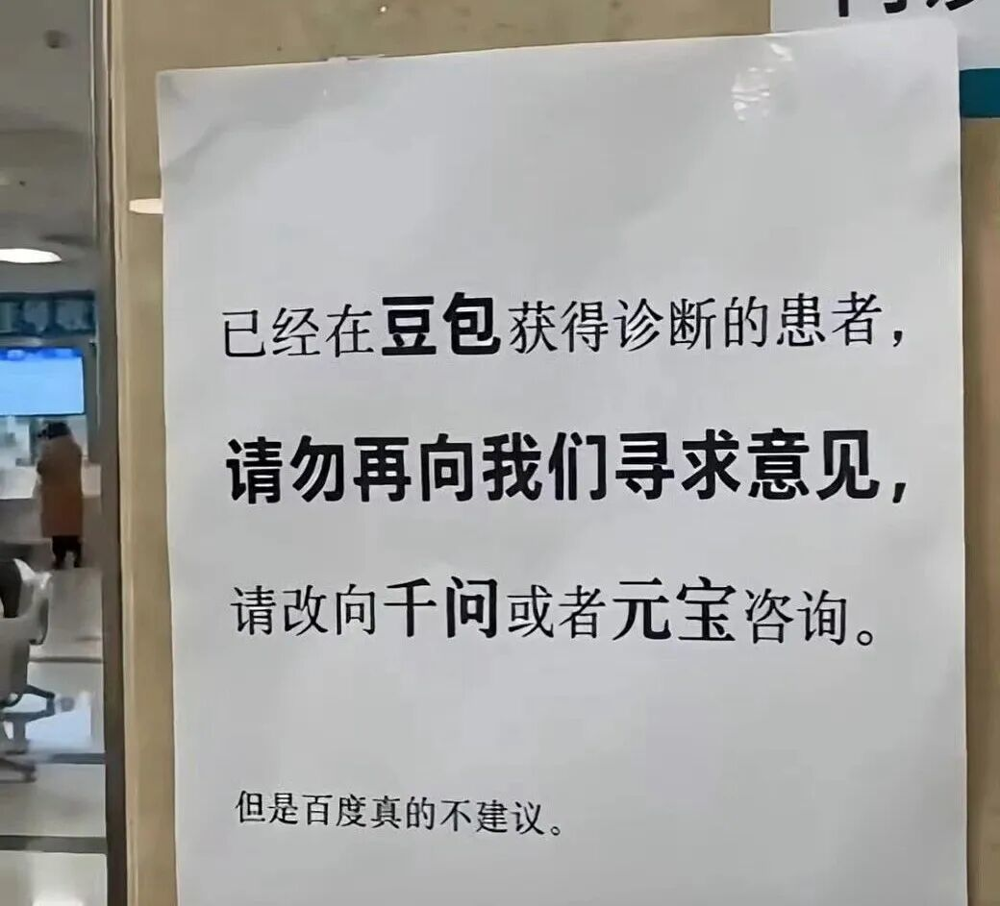

<p align="center"><a href="https://huggingface.co/datasets/yuzj1997yzj/WildAIGC-Bench"><b>Download dataset ↗</b></a> &nbsp; · &nbsp; <a href="https://yuzijian.github.io/WildAIGC-Bench/"><b>Explore the project ↗</b></a> &nbsp; · &nbsp; <a href="https://arxiv.org/abs/2610.28087"><b>Read the paper ↗</b></a></p>

**WildAIGC-Bench** tests AI-image detection on photographic-looking images tied to real news events and online claims, collected after actual web and social-media circulation.

- **Broad coverage.** News websites, fact-checking sources and social media, spanning public figures, social affairs, disasters and everyday scenes. Images retain the conditions encountered in real online circulation.
- **Timely updates.** Ongoing discovery, screening and preliminary annotation track newly circulating images. Human-reviewed additions enter future releases, while published evaluation sets remain fixed.
- **Human-verified labels.** Each included image is manually checked against image-specific AI evidence, including creator disclosures, platform watermarks or fact-checking findings.

## News

- **2026.10.30** — **V2 is being prepared for release:** 600 human-reviewed AI-generated and edited images, including 193 additions to V1.
- **2026.10.20** — Our [paper](https://arxiv.org/abs/2610.28087) is available on arXiv.
- **2026.10** — [WildAIGC-Bench V1](https://huggingface.co/datasets/yuzj1997yzj/WildAIGC-Bench) released with 407 human-reviewed AI-generated and edited images.

## Selected examples

| Animal story | Historical landmark | World Cup stadium |
|:---:|:---:|:---:|
|  |  |  |

| Retail poster | Hospital notice | Earthquake scene |
|:---:|:---:|:---:|
|  |  |  |

Illustrative AI-generated / edited examples from V1. [Explore images and source context →](https://yuzijian.github.io/WildAIGC-Bench/#dataset)

## A revealing test for today’s detectors


The highest processed recall among the displayed configurations is **60.93%**. External means equally weight nine benchmarks. Higher recall alone does not establish better overall detection performance; WildAIGC v1.0 contains AI images only.

[Explore interactive results →](https://yuzijian.github.io/WildAIGC-Bench/#evaluation) · [Full tables and external FPR →](docs/detailed-results.md)

## Get started

```python
from datasets import load_dataset

ds = load_dataset("yuzj1997yzj/WildAIGC-Bench", split="test")
image = ds[0]["processed_image"]
print(ds[0]["sample_id"], ds[0]["label"])
```

- **Processed:** target-region crop where needed, with no resizing; otherwise identical to raw.
- **Raw:** the acquired online file.
- **Metadata:** labels, event context, evidence summaries and source links.

Report the dataset revision and image version used. See [data format and usage](docs/dataset.md) for the file layout and integrity checks.

## From online circulation to a benchmark


Source context supports manual annotation; **evaluated detectors receive images alone**. General-purpose detector outputs were not used to select samples. This is a curated challenge set, not an estimate of the entire internet’s AI-image distribution.

## Dataset profile


Resolution is measured by the shorter edge in pixels. Source counts describe recorded report websites, not necessarily the original social platforms.

## Explore further

| Resource | What you will find |
|:---|:---|
| [Hugging Face dataset](https://huggingface.co/datasets/yuzj1997yzj/WildAIGC-Bench) | Images, labels, context and dataset preview |
| [Project page](https://yuzijian.github.io/WildAIGC-Bench/) | Interactive examples, figures and dataset statistics |
| [Dataset guide](docs/dataset.md) | Construction overview, raw/processed semantics and metadata |
| [Evaluation guide](docs/evaluation.md) | Metrics, sampling and comparison scope |
| [Result tables](docs/detailed-results.md) | Per-benchmark performance and crop analysis |
| [Metric scorer](scripts/score_predictions.py) | Score your own normalized predictions |

PE-336 and PE-518 are our trained baselines, combining PE-Core-Large (Perception Encoder) with a classification head. Their names indicate input resolution; see the [technical report](https://arxiv.org/abs/2610.28087) for further discussion.

## Citation and feedback

See our [technical report on arXiv](https://arxiv.org/abs/2610.28087). Please cite:

```bibtex
@misc{yu2026wildaigcbench,
  title={WildAIGC-Bench: Can AI Image Detectors Handle the Wild? A Benchmark of Generated and Edited Images in Online Circulation},
  author={Zijian Yu and Hangwei Zhang and Jun Lan and Huijia Zhu and Weiqiang Wang and Jianfu Zhang},
  year={2026},
  eprint={2610.28087},
  archivePrefix={arXiv},
  primaryClass={cs.CV},
  url={https://arxiv.org/abs/2610.28087}
}
```

Please also identify the dataset version and revision used in your evaluation.

Read the dataset [LICENSE](https://huggingface.co/datasets/yuzj1997yzj/WildAIGC-Bench/blob/main/LICENSE) for metadata licensing and third-party image rights. For corrections or rights concerns, [open an issue](https://github.com/YuZijian/WildAIGC-Bench/issues) with the relevant sample ID.

**If WildAIGC-Bench is useful to your research, consider starring this repository to follow the project.**
