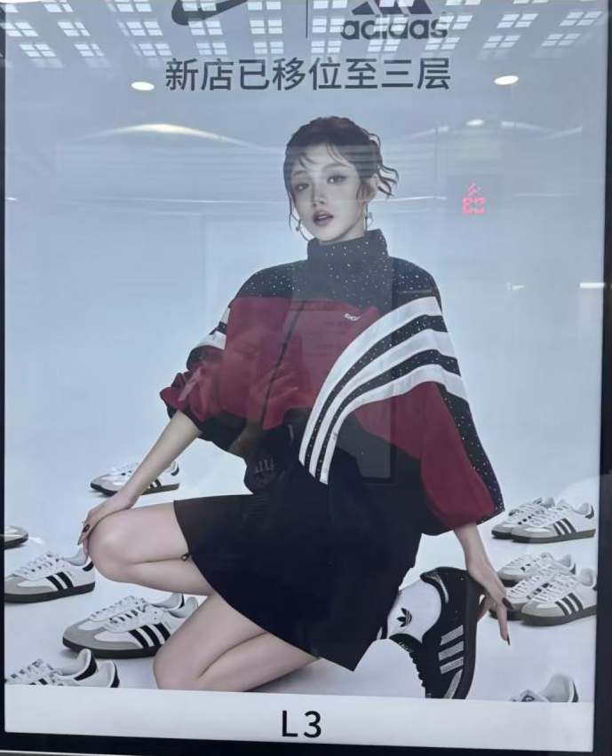
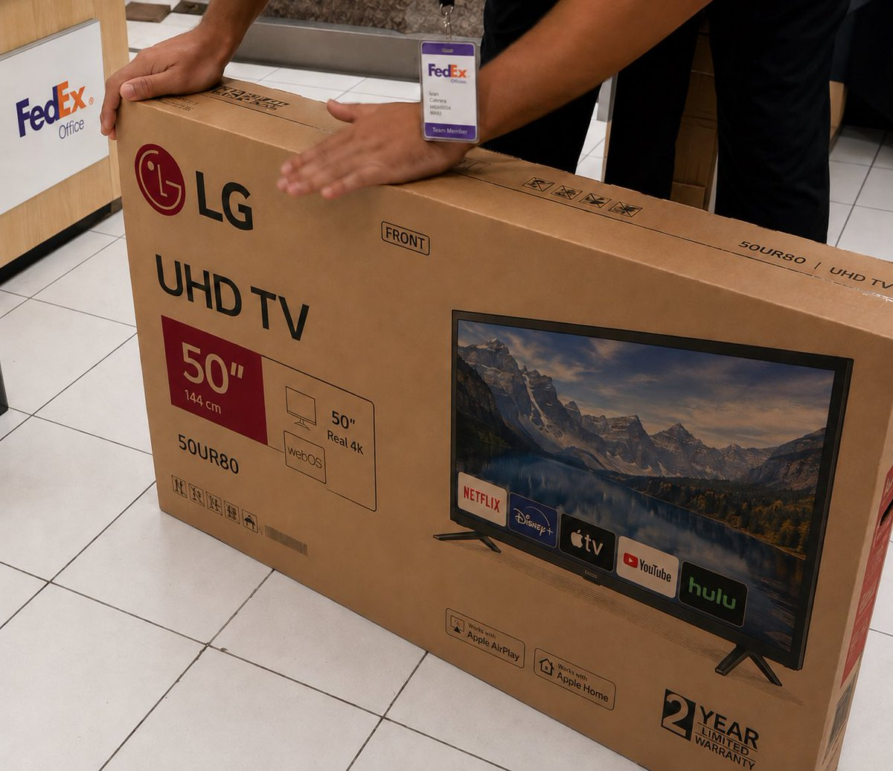
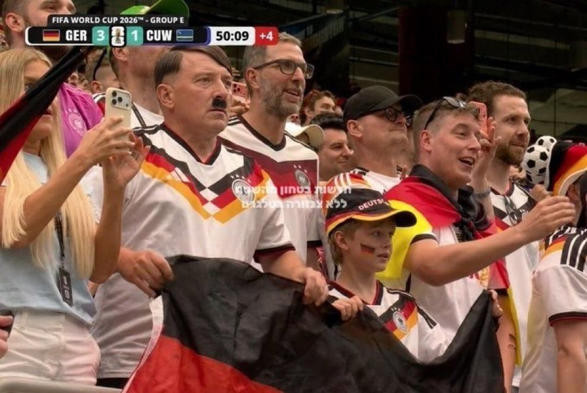
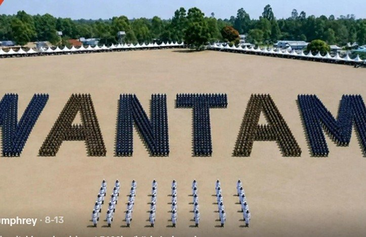
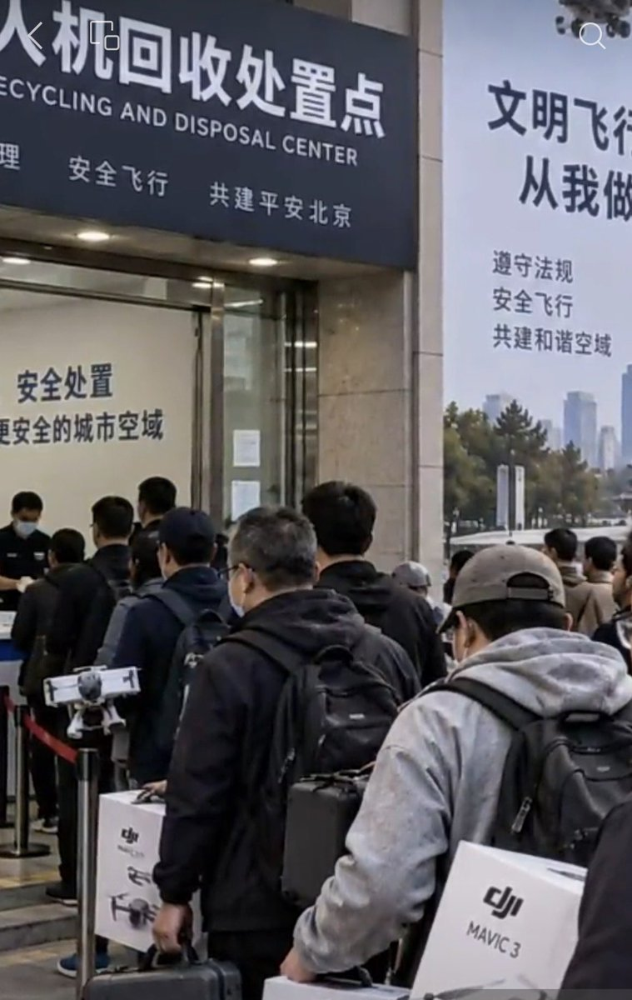
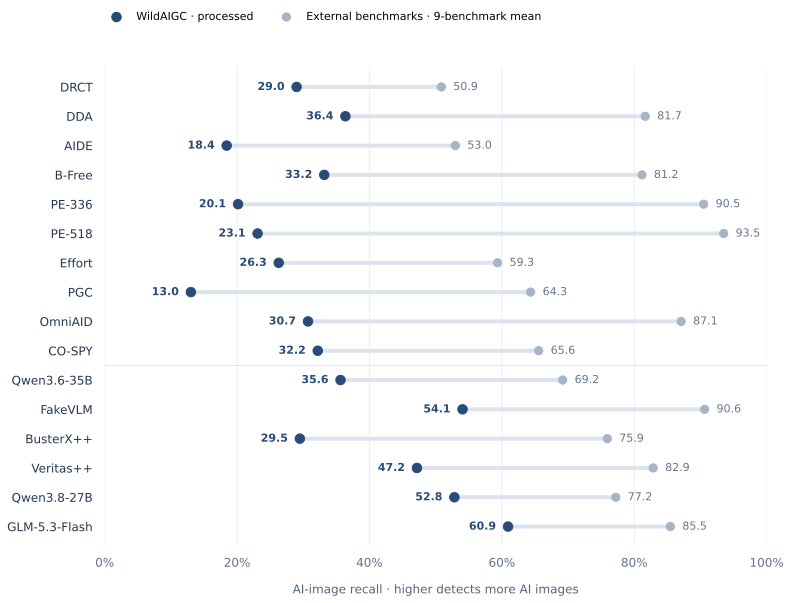
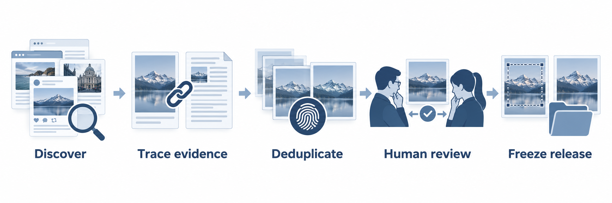

<div align="center">

# WildAIGC-Bench

### AI images behind real news events and online claims.
### A hard test for today’s detectors.

**407 human-annotated AI images · Real online circulation · Photographic appearance**

[**🤗 Dataset**](https://huggingface.co/datasets/yuzj1997yzj/WildAIGC-Bench) &nbsp; · &nbsp; [**Project page ↗**](https://yuzijian.github.io/WildAIGC-Bench/) &nbsp; · &nbsp; [**Results**](docs/detailed-results.md) &nbsp; · &nbsp; **Technical report — coming soon**

</div>

WildAIGC-Bench brings together AI-generated and edited images tied to real news events, collected from their circulation across the web and social media. It preserves the image files found online, including the effects of actual sharing rather than artificially simulated degradation. These photographic-looking images challenge detectors that perform well on other benchmark collections.

| From real news events. Through real social feeds. | Human-verified labels | Detector blind spots |
|:---|:---|:---|
| AI imagery tied to news events, collected after actual web and social-media circulation, without artificially simulated degradation. | Every image manually checked, with source evidence supporting its AI label. | All evaluated detectors show lower recall here than their average across external benchmarks. |

## A look at the collection

<table>
<tr>
<td align="center" width="33%"><br><sub>Retail poster</sub></td>
<td align="center" width="33%"><br><sub>Everyday scene</sub></td>
<td align="center" width="33%"><br><sub>Local image editing</sub></td>
</tr>
<tr>
<td align="center"><br><sub>Celebrity event</sub></td>
<td align="center"><br><sub>Public-event claim</sub></td>
<td align="center"><br><sub>Urban scene</sub></td>
</tr>
</table>

Illustrative processed examples. [Enlarge images and explore their source context →](https://yuzijian.github.io/WildAIGC-Bench/#dataset)

## How do detectors perform?



The comparison uses AI-image recall on WildAIGC processed and an equally weighted mean across the same external benchmarks for every method. It reveals a challenge across evaluated detectors; it does not isolate the cause of the performance gap.

**WildAIGC is positive-only.** Higher recall alone does not establish better overall detection performance. Real-image FPR, raw/processed results and supplementary accuracy are available in the [full results](docs/detailed-results.md); see the [evaluation protocol](docs/evaluation.md) for metric definitions and sampling scope.

## Get started

```python
from datasets import load_dataset

ds = load_dataset("yuzj1997yzj/WildAIGC-Bench", split="test")
image = ds[0]["processed_image"]
print(ds[0]["sample_id"], ds[0]["label"])
```

- **Processed:** target-region crop where needed, with no resizing; otherwise identical to raw.
- **Raw:** the acquired online file.
- **Metadata:** labels, event context, evidence summaries and source links.

Report the dataset revision and image version used. See [data format and usage](docs/dataset.md) for the file layout and integrity checks.

## From online circulation to a benchmark



Source context supports manual annotation; **evaluated detectors receive images alone**. General-purpose detector outputs were not used to select samples. This is a curated challenge set, not an estimate of the entire internet’s AI-image distribution.

## Explore further

| Resource | What you will find |
|:---|:---|
| [Hugging Face dataset](https://huggingface.co/datasets/yuzj1997yzj/WildAIGC-Bench) | Images, labels, context and dataset preview |
| [Project page](https://yuzijian.github.io/WildAIGC-Bench/) | Interactive examples, figures and dataset statistics |
| [Dataset guide](docs/dataset.md) | Construction overview, raw/processed semantics and metadata |
| [Evaluation guide](docs/evaluation.md) | Metrics, sampling and comparison scope |
| [Result tables](docs/detailed-results.md) | Per-benchmark performance and crop analysis |
| [Metric scorer](scripts/score_predictions.py) | Score your own normalized predictions |

PE-336 and PE-518 are our trained baselines, combining PE-Core-Large (Perception Encoder) with a classification head. Their names indicate input resolution; additional discussion will accompany the technical report.

## Citation and feedback

The technical report and formal citation are in preparation. For now, cite **WildAIGC-Bench v1.0**, this repository and the dataset revision used.

Read the dataset [LICENSE](https://huggingface.co/datasets/yuzj1997yzj/WildAIGC-Bench/blob/main/LICENSE) for metadata licensing and third-party image rights. For corrections or rights concerns, [open an issue](https://github.com/YuZijian/WildAIGC-Bench/issues) with the relevant sample ID.

**If WildAIGC-Bench is useful to your research, consider starring this repository to follow the project.**
