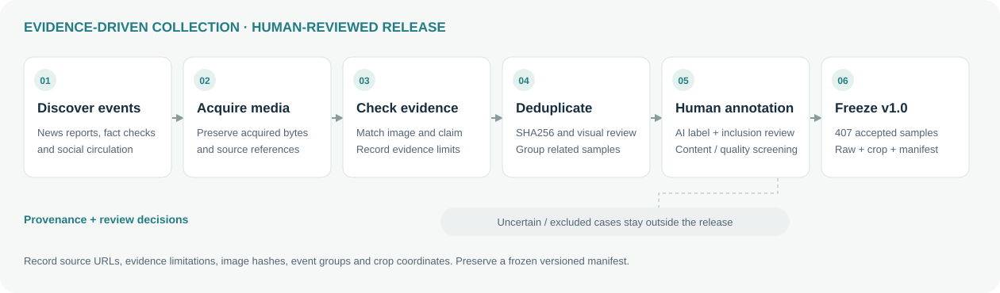
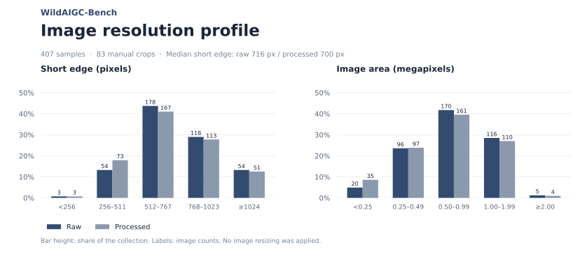

# WildAIGC-Bench

**A hard benchmark for AI-generated and edited image detection in real-world online circulation.**

[Project page](https://yuzijian.github.io/WildAIGC-Bench/) · [Dataset on Hugging Face](https://huggingface.co/datasets/yuzj1997yzj/WildAIGC-Bench) · [Evaluation notes](docs/evaluation.md) · [Construction and data format](docs/dataset.md) · [Issues](https://github.com/YuZijian/WildAIGC-Bench/issues)

The first release contains **407 human-reviewed AI images** connected to news events and social-media claims. Each sample includes recorded source references and evidence context. The collection targets photographic-looking content acquired from actual online circulation, rather than recreating propagation effects with a synthetic degradation recipe.

The dataset upload is underway; the technical report and formal paper citation are in preparation. This repository provides documentation, project-page source, reusable figures, example assets and structured evaluation results. The full image release is hosted on Hugging Face.

## Dataset at a glance

- **Positive-only test set:** all 407 accepted samples are labeled `aigc`. Standalone accuracy therefore equals AI-image recall; separate real-image controls are needed for false-positive rates and complete binary metrics.
- **Human review throughout:** each image was checked for authenticity label, release admission and whether a crop was needed.
- **Raw and processed versions:** raw preserves acquired bytes. Processed uses a rectangular crop of the target where needed, without resizing, inpainting or enhancement; otherwise it is byte-identical to raw.
- **Traceable context:** compact metadata records the image, claim, available evidence, limitations and source links. A separate manifest records dimensions, crop coordinates and hashes.
- **Frozen v1.0:** sample IDs and file hashes identify the release. Additional collection or corrections should use a new version and a changelog.

[Explore the six interactive examples on the project page →](https://yuzijian.github.io/WildAIGC-Bench/#dataset)

## Load the dataset

Once the Hugging Face upload is complete:

```python
from datasets import load_dataset

ds = load_dataset("yuzj1997yzj/WildAIGC-Bench", split="test")
sample = ds[0]
image = sample["processed_image"]  # default evaluation input
print(sample["sample_id"], sample["label"])
```

The `raw_image` column provides the acquired version. Both columns contain the corresponding original file bytes; decoded display size is not a benchmark transformation. Specify the version used when reporting results.

See [dataset format and provenance notes](docs/dataset.md) for fields, crop semantics, source gaps and exact-byte verification.

## Collection and release workflow



Discover an event → acquire relevant media → check image–claim correspondence and evidence → check duplicates and group related samples → human annotation and admission → crop where needed and freeze a release manifest.

The collection does not claim to reconstruct every image's complete reposting or compression history. Reported source findings and their limitations remain distinct from the final human annotation.

## Dataset statistics



[Source-website distribution](assets/source_website_distribution.svg) · [Statistics JSON](assets/statistics.json)

Source-website counts refer to recorded reports or fact-check pages, not necessarily the earliest publisher or original social platform. Counts are per image, not independent event counts.

## Evaluation snapshot

The project page presents two tables: cross-benchmark accuracy and WildAIGC raw/processed performance. The current displayed scope covers **10 selected methods**, with missing measurements left blank. Nine have completed WildAIGC results; B-Free is pending there.

| Method | WildAIGC raw recall | Processed recall |
|---|---:|---:|
| DRCT | 0.2948 | 0.2899 |
| DDA | 0.3538 | 0.3636 |
| AIDE | 0.1450 | 0.1843 |
| B-Free |  |  |
| PE-336 (best) | 0.1941 | 0.2015 |
| PE-518 (best) | 0.2236 | 0.2310 |
| Qwen3.6-35B (API) | 0.3661 | 0.3563 |
| FakeVLM | 0.5283 | 0.5405 |
| BusterX++ | 0.2973 | 0.2948 |
| Veritas++ | 0.4644 | 0.4717 |

[Complete tables on the project page →](https://yuzijian.github.io/WildAIGC-Bench/#evaluation) · [Structured results JSON](assets/evaluation_results.json)

These results are the maintainer-supplied **12 October 2026 snapshot**, not a new inference run. Some large-model benchmark dimensions use sampled subsets. Other-benchmark averages use completed dimensions only, and their accuracy gaps relative to positive-only WildAIGC are descriptive rather than matched-recall comparisons. See [evaluation scope and interpretation](docs/evaluation.md).

## Repository contents

```text
index.html / style.css / app.js   Project page and interactive examples
docs/dataset.md                  Construction, format and usage notes
docs/evaluation.md               Benchmark groups and evaluation caveats
assets/evaluation_results.json   Current displayed measurements
assets/statistics.json           Frozen-release statistics
assets/*.svg                     Editable construction and distribution figures
assets/sample_examples.json      Six example IDs and paired asset references
```

The public evaluation harness, complete model configurations and technical report are follow-up releases; they are not bundled here yet. Real-image false-positive-rate analysis is also planned.

## Citation, rights and corrections

Formal citation will be added with the technical report. For now, cite **WildAIGC-Bench v1.0**, the repository URL and the exact revision used.

See the dataset's [LICENSE](https://huggingface.co/datasets/yuzj1997yzj/WildAIGC-Bench/blob/main/LICENSE) for the distinction between maintainer-authored metadata and third-party image rights. Image source attribution is not a blanket image license. External benchmarks remain subject to their authors' access terms.

Use [repository issues](https://github.com/YuZijian/WildAIGC-Bench/issues) for corrections, rights concerns and reproducibility questions; include sample IDs or the relevant result configuration.
