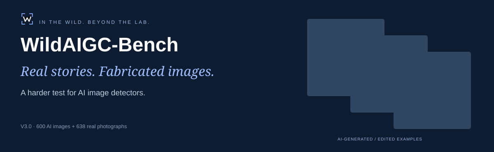
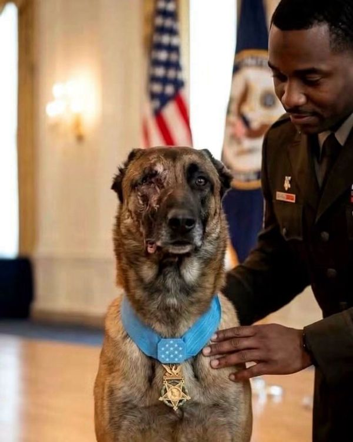
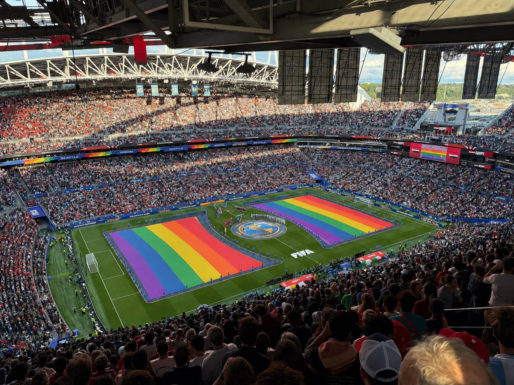
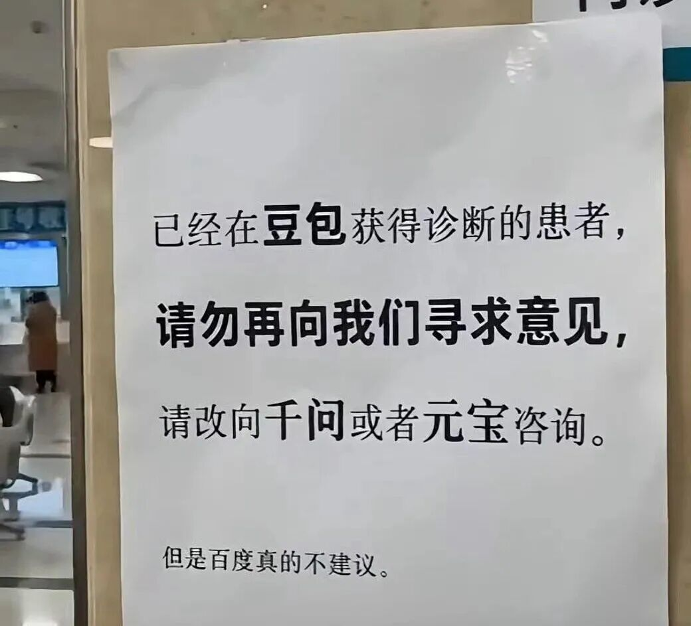
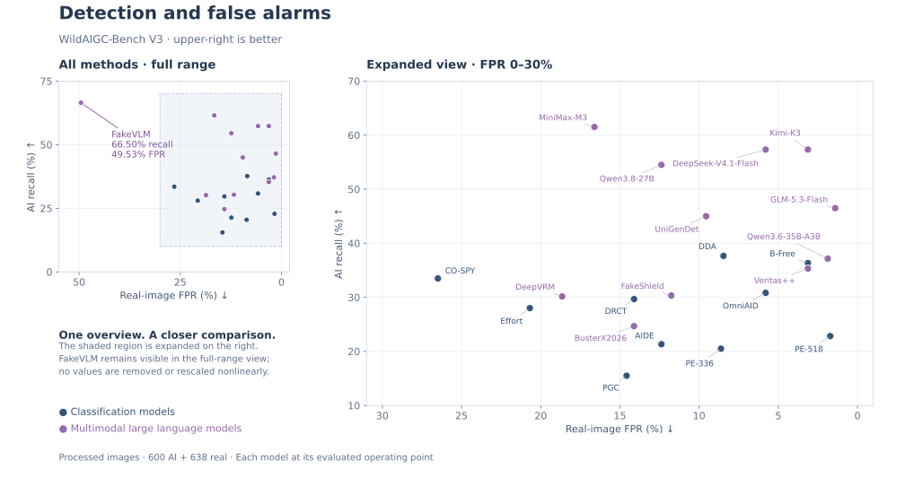
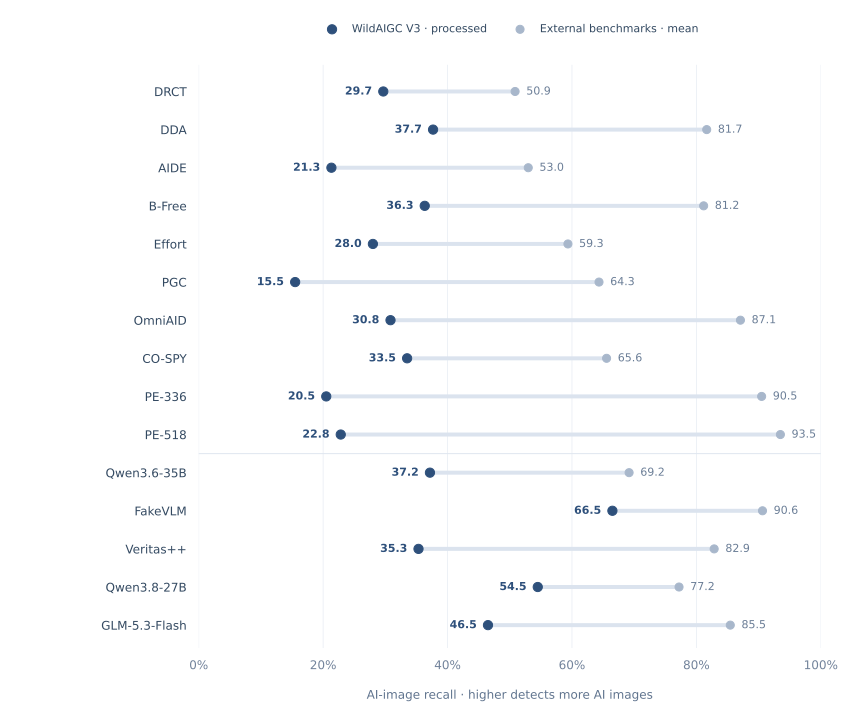
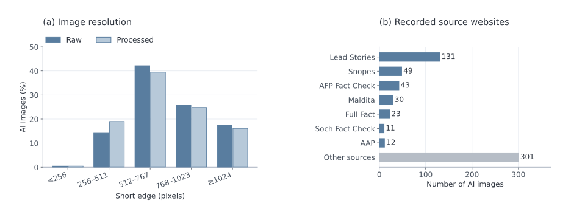

<p align="center">
  <a href="https://yuzijian.github.io/WildAIGC-Bench/"></a>
  &nbsp;
  <a href="https://huggingface.co/datasets/yuzj1997yzj/WildAIGC-Bench"></a>
  &nbsp;
  <a href="https://arxiv.org/abs/2610.28087"></a>
</p>

**WildAIGC-Bench** tests AI-image detection on photographic-looking images tied to real news events and online claims, collected after actual web and social-media circulation.

- **Broad coverage.** News websites, fact-checking sources and social media, spanning public figures, social affairs, disasters and everyday scenes. Images retain the conditions encountered in real online circulation.
- **Timely updates.** Ongoing discovery, screening and preliminary annotation track newly circulating images. Human-reviewed additions enter future releases, while published evaluation sets remain fixed.
- **Human-verified labels.** Each AI image is manually checked against image-specific evidence, including creator disclosures, platform watermarks or fact-checking findings. Real photographs are reviewed against their source provenance.

## News

- 🚀 `2026.11.03` **V3 is released!** Adding **638 real photographs** alongside **600 AI images**, with confirmed reference relationships for a subset. [Dataset](https://huggingface.co/datasets/yuzj1997yzj/WildAIGC-Bench)

- 🚀 `2026.10.30` **V2 is released!** Now **600 images**, with 193 new samples. [Dataset](https://huggingface.co/datasets/yuzj1997yzj/WildAIGC-Bench)
- 📄 `2026.10.20` Our **paper** is on arXiv: *Can AI Image Detectors Handle the Wild?* [Paper](https://arxiv.org/abs/2610.28087)
- 🎉 `2026.10.15` **WildAIGC-Bench V1 is released** with **407 human-reviewed images**. [Dataset](https://huggingface.co/datasets/yuzj1997yzj/WildAIGC-Bench/tree/0b043a1dd41e694749227af8610930cc86049747)

V3 adds real-image controls for false-positive evaluation alongside AI-image recall. Real labels are supported by photographic sources and human review; the complete editing history may not be known.

## Selected examples

| Animal story | Historical landmark | World Cup stadium |
|:---:|:---:|:---:|
|  |  |  |

| Retail poster | Hospital notice | Earthquake scene |
|:---:|:---:|:---:|
|  |  |  |

Illustrative AI-generated / edited examples from V1. [Explore images and source context →](https://yuzijian.github.io/WildAIGC-Bench/#dataset)

## Detect the fake. Trust the real.

**V3 evaluation · 600 AI images + 638 real photographs.** We report AI recall, real-image false-positive rate and balanced accuracy together.



The overview includes all displayed methods; the main plot expands FPR 0–30%. **Upper-right is better** in both views.

**Kimi-K3 has the highest displayed balanced accuracy (77.10%)**, with 57.33% AI recall and 3.13% FPR. **FakeVLM has the highest recall (66.50%)**, but also 49.53% FPR. Results use processed images at each model’s evaluated operating point; recall alone does not establish overall detection performance.

### A revealing test for today’s detectors



WildAIGC scores use **V3 · 600 AI images**. External means equally weight the nine previously evaluated benchmarks. Only methods with available external results are shown; evaluation configurations may differ between runs.

[Explore V3 results →](https://yuzijian.github.io/WildAIGC-Bench/#evaluation) · [Full V3 table](docs/detailed-results.md) · [Cross-benchmark recall comparison](docs/cross-benchmark-v3.md)

The cross-benchmark comparison uses **V3 processed recall** alongside existing external evaluations; recall drop is their difference in percentage points. The paper’s original **V1 results remain archived separately** in the [historical tables](docs/results-v1.md).

## Dataset releases

| Release | Images | Scope |
|:---|---:|:---|
| [**V3 · latest**](https://huggingface.co/datasets/yuzj1997yzj/WildAIGC-Bench) | **1,238** | 600 AI images + 638 real photographs |
| [V2 · frozen](https://huggingface.co/datasets/yuzj1997yzj/WildAIGC-Bench/tree/a446d52c5f59e18e87266ca96c0ca48193a422ac) | 600 | AI-image cohort retained unchanged in V3 |
| [V1 · frozen](https://huggingface.co/datasets/yuzj1997yzj/WildAIGC-Bench/tree/0b043a1dd41e694749227af8610930cc86049747) | 407 | Original images used in the paper and published evaluations |

The per-sample `version` field records first inclusion. For release history, see the dataset [change log](https://huggingface.co/datasets/yuzj1997yzj/WildAIGC-Bench/blob/main/CHANGELOG.md).

## Get started

```python
from datasets import load_dataset

ds = load_dataset("yuzj1997yzj/WildAIGC-Bench", split="test")
ai = ds.filter(lambda x: x["label"] == "aigc")  # 600
real = ds.filter(lambda x: x["label"] == "real")  # 638
image = ds[0]["processed_image"]
print(ds[0]["sample_id"], ds[0]["label"])
```

- **Processed:** target-region crop where needed, with no resizing; otherwise identical to raw.
- **Raw:** the acquired online file.
- **Real photographs:** processed reuses raw, with no additional transformation.
- **Reference relationships:** 44 confirmed links distinguish editing originals from same-event photographs. [View examples →](https://yuzijian.github.io/WildAIGC-Bench/#reference-pairs)
- **Metadata:** labels, event context, evidence summaries and source links.

To reproduce the paper’s original V1, pass `revision="0b043a1dd41e694749227af8610930cc86049747"` to `load_dataset`. Use this fixed revision for the original evaluation files.

Report the dataset revision and image version used. See [data format and usage](docs/dataset.md) for the file layout and integrity checks.

## From online circulation to a benchmark


Source context supports manual annotation; **evaluated detectors receive images alone**. General-purpose detector outputs were not used to select the AI-image cohort. This is a curated challenge set, not an estimate of the entire internet’s AI-image distribution.

## Dataset profile · V3 AI-image cohort (600 images)



These charts cover the 600 AI images only; real photographs are excluded. Resolution compares raw and processed versions by shorter-edge length. Source counts describe recorded report websites, not necessarily the original social platforms.

## Explore further

| Resource | What you will find |
|:---|:---|
| [Hugging Face dataset](https://huggingface.co/datasets/yuzj1997yzj/WildAIGC-Bench) | Images, labels, context and dataset preview |
| [Project page](https://yuzijian.github.io/WildAIGC-Bench/) | Interactive examples, figures and dataset statistics |
| [Dataset guide](docs/dataset.md) | Construction overview, raw/processed semantics and metadata |
| [Evaluation guide](docs/evaluation.md) | Metrics, sampling and comparison scope |
| [V3 result tables](docs/detailed-results.md) | Recall, FPR, balanced accuracy and raw/processed comparison |
| [Cross-benchmark comparison](docs/cross-benchmark-v3.md) | External recall, V3 recall and the difference |
| [Metric scorer](scripts/score_predictions.py) | Score your own normalized predictions |

PE-336 and PE-518 are our trained baselines, combining PE-Core-Large (Perception Encoder) with a classification head. Their names indicate input resolution; see the [technical report](https://arxiv.org/abs/2610.28087) for further discussion.

## Citation and feedback

See our [technical report on arXiv](https://arxiv.org/abs/2610.28087). Please cite:

```bibtex
@misc{yu2026wildaigcbench,
  title={WildAIGC-Bench: Can AI Image Detectors Handle the Wild? A Benchmark of Generated and Edited Images in Online Circulation},
  author={Zijian Yu and Hangwei Zhang and Jun Lan and Huijia Zhu and Weiqiang Wang and Jianfu Zhang},
  year={2026},
  eprint={2610.28087},
  archivePrefix={arXiv},
  primaryClass={cs.CV},
  url={https://arxiv.org/abs/2610.28087}
}
```

Please also identify the dataset version and revision used in your evaluation.

Read the dataset [LICENSE](https://huggingface.co/datasets/yuzj1997yzj/WildAIGC-Bench/blob/main/LICENSE) for metadata licensing and third-party image rights. For corrections or rights concerns, [open an issue](https://github.com/YuZijian/WildAIGC-Bench/issues) with the relevant sample ID.

**If WildAIGC-Bench is useful to your research, consider starring this repository to follow the project.**
